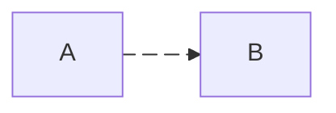

https://docs.github.com/zh/get-started/writing-on-github/working-with-advanced-formatting

- 换行：在行末使用双空格或`<br/>`或`\`
- wikilink `[[文件路径|显示内容]]`
    - 点击链接则自动创建目录与文件

## 文字

**粗体**
~~删除~~

---

```md
**粗体**
~~删除~~
```

## 任务列表

- [ ] 未完成
- [x] 已完成

---

```md
- [ ] 未完成
- [x] 已完成
```

## 换行

- 列表段软换行
  （回车缩进的第二行）

- 列表段硬换行  
  （双空格+回车缩进的第二行）

  空行第3段，列表项内空行保持

  空行第4段，列表项内空行保持

---

```md
- 列表段软换行
  （回车缩进的第二行）

- 列表段硬换行  
  （双空格+回车缩进的第二行）

  空行第3段，列表项内空行保持

  空行第4段，列表项内空行保持
```

## 标记

> 普通标记

> [!note] note 标记

> [!tip] tip 标记

> [!warning] warning 标记

---

```md
> 普通标记

> [!note] note 标记

> [!tip] tip 标记

> [!warning] warning 标记
```

## diff 版本差异

```diff
- 删除内容
+ 添加内容
```

---

``````md
```diff
- 删除内容
+ 添加内容
```
``````

## mermaid 花哨的富文本渲染

https://mermaid.js.org/intro/syntax-reference.html

预期使用图形化工具创建数据，再提取代码栏。而不是花费大量精力使用文本构造渲染

> [!warning] github 常见 `Unable to render rich display`

版本

```mermaid
  info
```

---

``````md
```mermaid
  info
```
``````

---
---

任意示例



---

``````md

``````

## 链接

[基础链接](https://example.net)
[拥有说明的链接](https://example.net "引号或括号包裹的悬浮链接说明")

---

```md
[基础链接](https://example.net)
[拥有说明的链接](https://example.net "引号或括号包裹的悬浮链接说明")
```

### 快捷引用链接

https://github.github.com/gfm/#shortcut-reference-link

[快捷引用]

[快捷引用]: https://exmaple.net (引号或括号包裹的悬浮链接说明)

---

```md
快捷引用标记：实际显示但本身未设置 url
[快捷引用]

快捷引用定义：不显示，但设置 url 以作用到所有同名快捷引用
[快捷引用]: https://exmaple.net (引号或括号包裹的悬浮链接说明)
```

## 脚注

https://githubdocs.cn/en/get-started/writing-on-github/getting-started-with-writing-and-formatting-on-github/basic-writing-and-formatting-syntax#footnotes

[^脚注]

[^脚注]: https://exmaple.net (引号或括号包裹的悬浮链接说明)

---

```md
与快捷引用类似，⚠️ 或为 VSCode 预览与 GFM 支持差异
脚注引用标记：实际显示但本身未设置 url
[^脚注]

脚注定义：不显示，但设置 url 以作用到所有同名快捷引用
[^脚注]: https://exmaple.net (引号或括号包裹的悬浮链接说明)
```


## details 折叠区块

<details>
<summary>内容默认隐藏的折叠区块标记</summary>

默认隐藏的文本

### 折叠区块头部

折叠区块文本

```py
# 折叠区块代码块
```

</details>


<details open>
<summary>设置 `open` 属性后内容展开的折叠区块标记</summary>

展开的文本

</details>

---

``````md
<details>
<summary>内容默认隐藏的折叠区块标记</summary>

默认隐藏的文本

### 折叠区块头部

折叠区块文本

```py
# 折叠区块代码块
```

</details>


<details open>
<summary>设置 `open` 属性后内容展开的折叠区块标记</summary>

展开的文本

</details>
``````