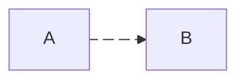

https://docs.github.com/zh/get-started/writing-on-github/working-with-advanced-formatting

## 文字

**粗体**
~~删除~~

```md
**粗体**
~~删除~~
```

## 任务列表

- [ ] 未完成
- [x] 已完成

```md
- [ ] 未完成
- [x] 已完成
```

## 标记

> 普通标记

> [!note] note 标记

> [!tip] tip 标记

> [!warning] warning 标记

```md
> 普通标记

> [!note] note 标记

> [!tip] tip 标记

> [!warning] warning 标记
```

## diff 版本差异

```diff
- 删除内容
+ 添加内容
```

``````md
```diff
- 删除内容
+ 添加内容
```
``````

## mermaid 花哨的富文本渲染

https://mermaid.js.org/intro/syntax-reference.html

预期使用图形化工具创建数据，再提取代码栏。而不是花费大量精力使用文本构造渲染

> [!warning] github 常见 `Unable to render rich display`

版本

```mermaid
  info
```

``````md
```mermaid
  info
```
``````

任意示例


``````md

``````

